# The Linux Ecosystem

## 01. The Hardware (First layer, the ground floor)

- CPU : That does the math.
- RAM : That holds the work, what's being work on.
- SSD : That stores everything. (Every Type of file)
- GPU : Graphics Card.
- NIC : Network Interface Card.

- The hardware is the most expensive unit.

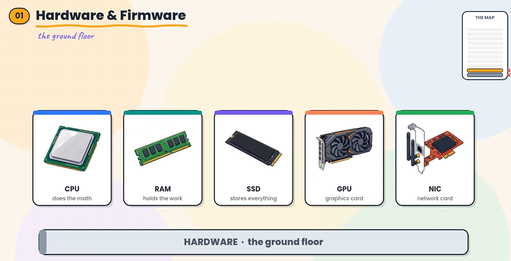

- When you press power button the firmware `wakes up` and in the older machine it was known as `BIOS (Basic Input/Output System)` and every modern pc it is now 

### `UEFI (Unified Extensible Firmware Interface)`.:
  
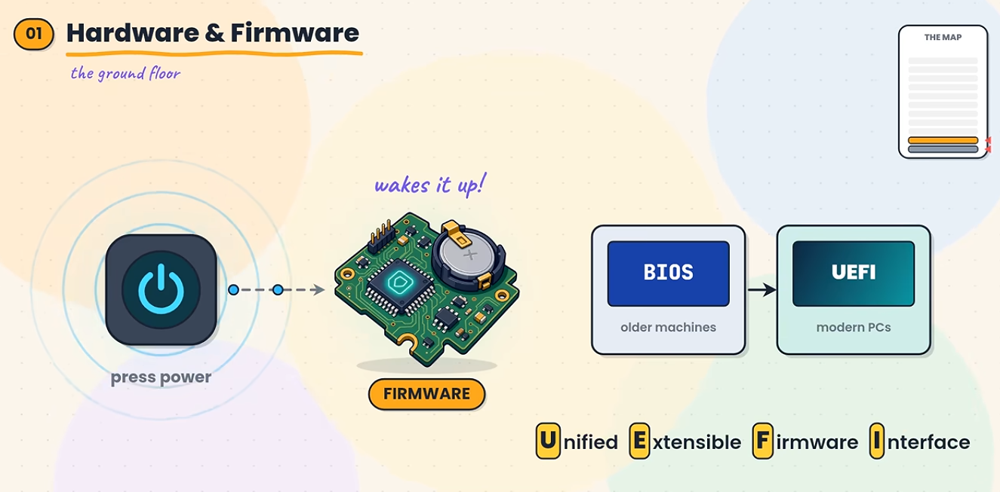

- Think of UEFI as a security guard.
- It checks everything first when machine powered-on.
- It does `self-test` (It checks health for CPU, Memory and Devices.)
- It also asks `who is in charge` for starting the operating system. 

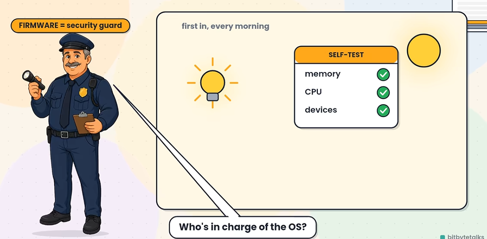

- The UEFI look for the small partition on the disk called EFI (EFI system partition)
- It picks the boot loader (grub64.efi-GRUB) from it and handsover the control.

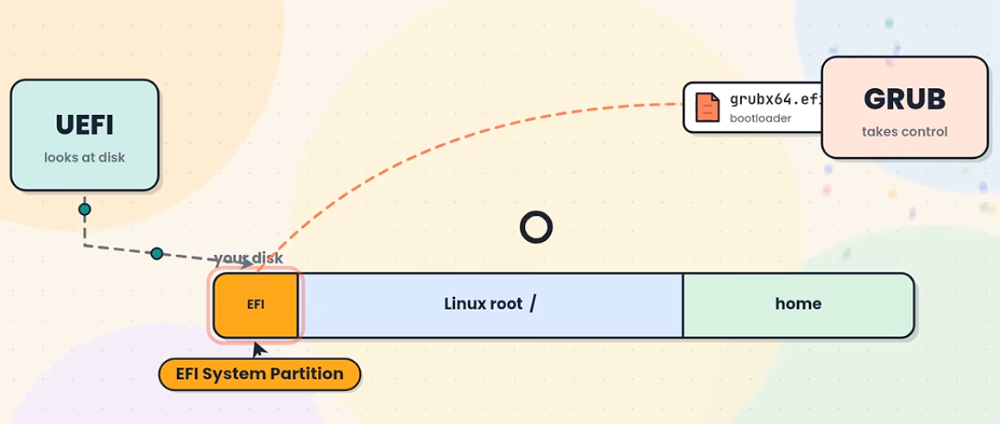

### 02 GRUB (Grand Unified Bootloader): 
- GRUBs job is very small but absolutely critical.

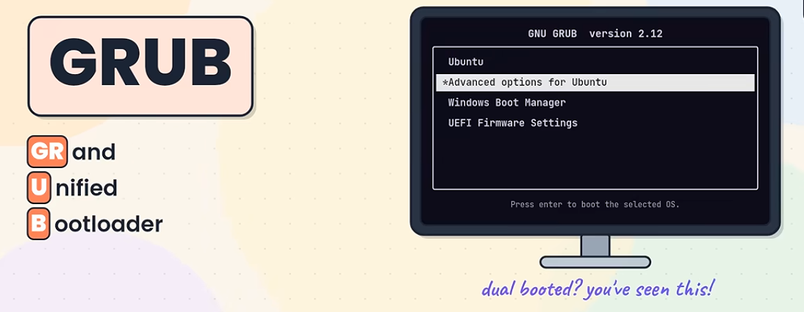

- It finds the Linux Kernel file on the disk called as `vmlinuz` (the linux kernel file.)
- Then it loads that file into memory (RAM) and also loads a little helper called `initramfs`.
- The `initramfs` is tiny, temporary filesystem, just packed with enough drivers to find and mount your real disk.
- It also passes the kernel few more instructions called `The kernel command line`
  (root=/dev/nvme0n1p2 ro quiet splash) and then GRUB steps aside.

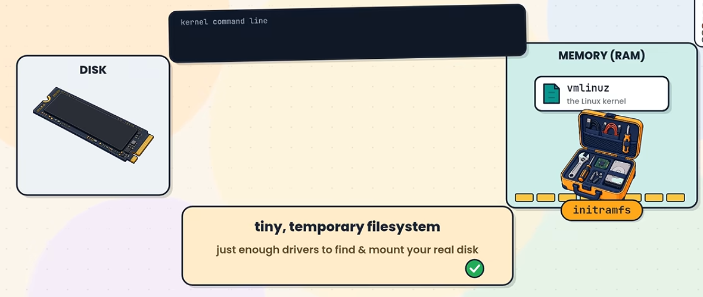

- GRUB is the stage manager, it doesn't perform, it just gets the `star` onto the stage.

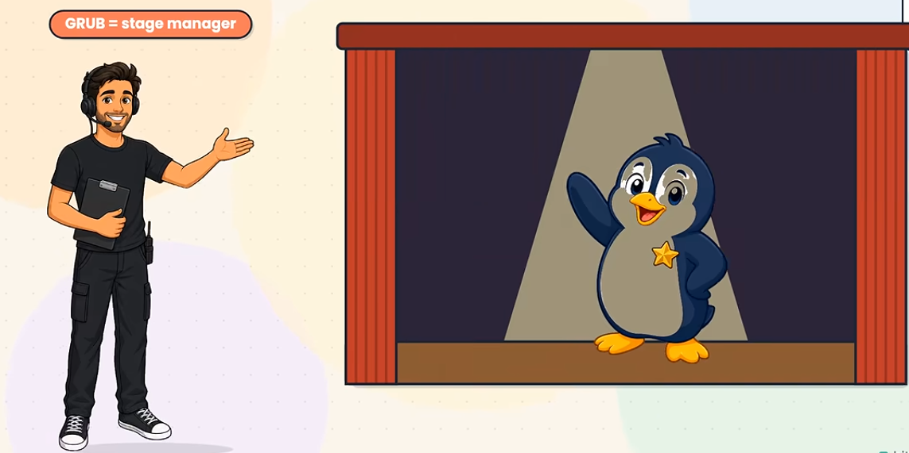

### 03. The Linux Kernel (The Big Star)

- Technically, `Linux is only this one layer`.
- Linux is the `Kernel`.
- This does everything. 

#### Real World Scenario to better understand the `KERNEL Scenario`

- Imagine the Hotel, in which the hardware is the 'Kitchen'
- The apps are your customer and apps doesn't directly enter into the Hotel's Kitchen.
- The Kernel is the Kitchen Staff, it owns the Hardware (the kitchen) and everything must ask politely.
- That polite request is called `System Call`.
- For example if application wants to read a file read(), it can't touch the disk directly. It makes a system call like read(), write() or open() etc. And the Kernel does the work hands back the result.

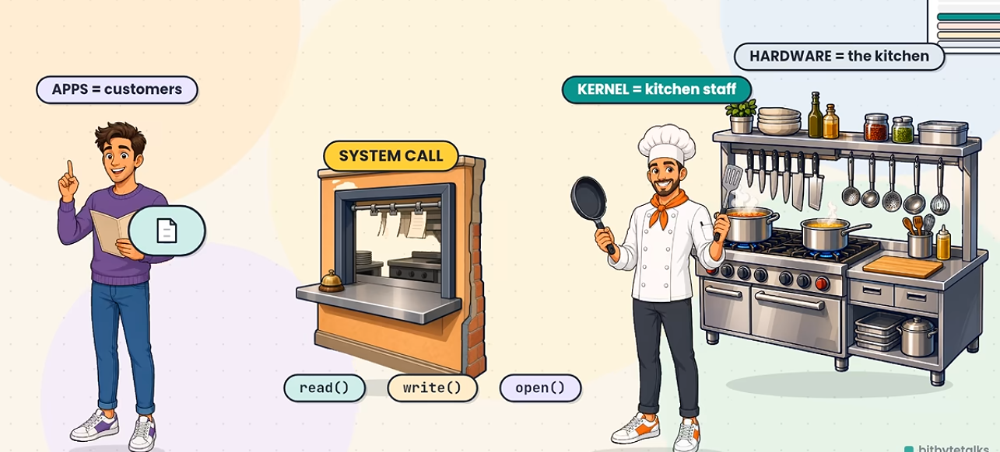

- System calls are like order windows between the customers and the kitchen.

### 04. Drivers and Schedulers (The Translators)

- The drivers are the translators that the Kernel talk to your Wi-Fi chip, your GPU, your GPO, your USB stick and many drivers are `loadable modules`.

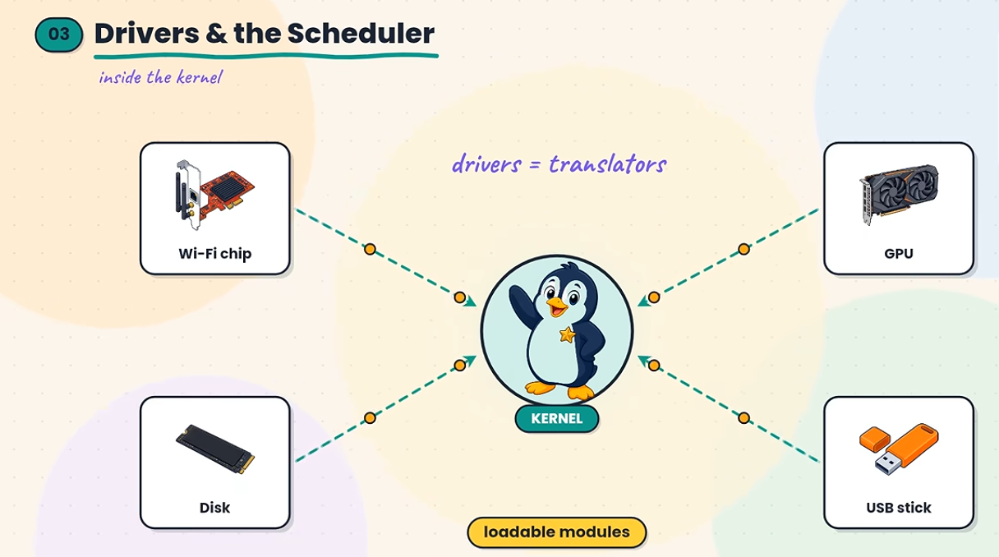

- It plug-in cartridges into the running kernel when needed, and removed without rebooting. The `$ lsmod` and `$ mdoprobe` manage them

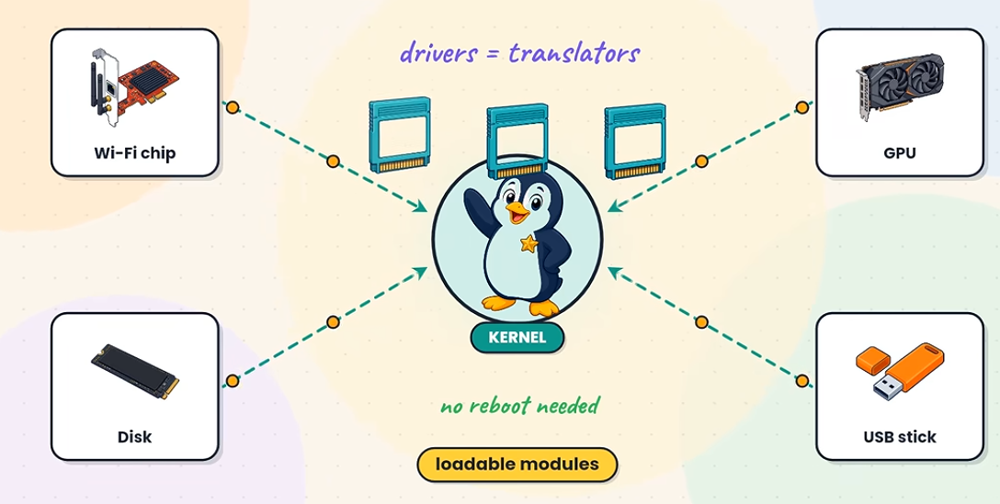

#### The Scheduler: Decides who is next to execute.

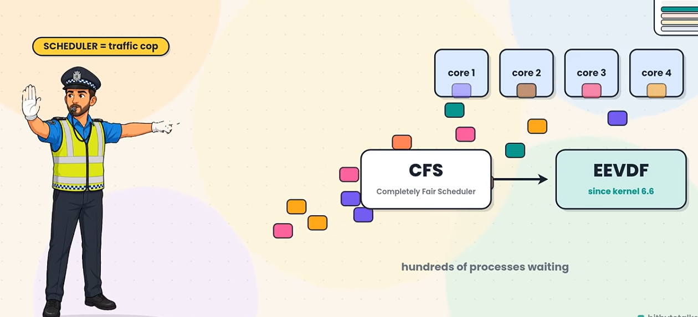

- You have a handful of `CPU Cores` but hundreds of processes are waiting.
- The scheduler is like a traffic cop deciding who run next.
- It switches so fast and everything is simultaneous.
- For years the Linux use CFS (Completely Fair Scheduler).
- However, since the Kernel 6.6 it uses EEVDF (A new design).
- Earliest Eligible Virtual Deadline First.

### 05. The Memory and VFS (Memory Manager)

- Every process thinks it has own private block of memory, an illusion is called Virtual Memory (a friendly illusion) .
- A kernel maps it onto a real RAM in small chunks called pages, and can push less used out to swap.

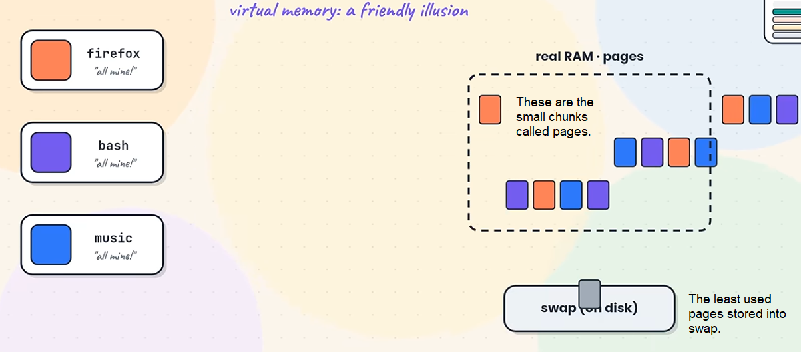

- If memory truly runs out, the last-resort bouncer called `OOMKILLER` shuts down the process to save the system.
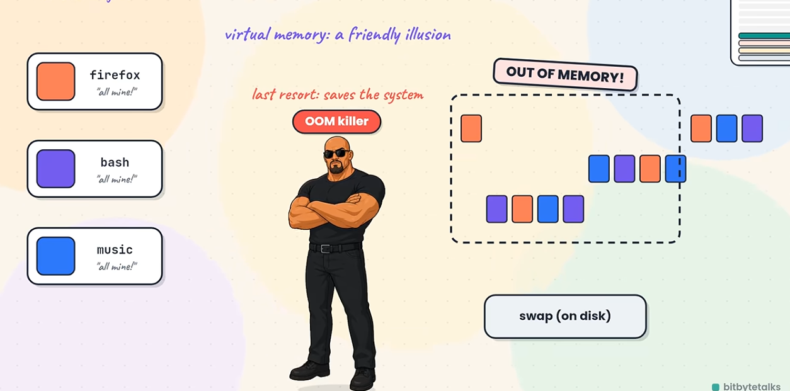

#### VFS (The virtual file system):

- Your file lives on the different formats like ext4, btrfs, FAT USB, or network share.
- The virtual file system `shares one common interface`, the big part of UNIX idea is `Everything is a file`

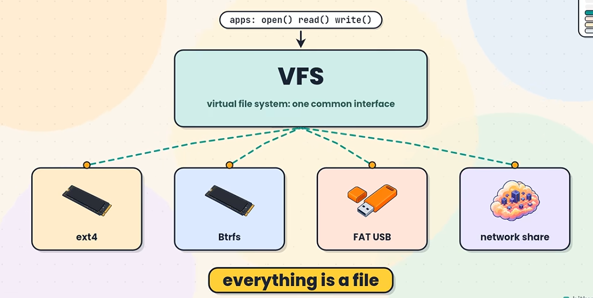

- It's like heart with no body. 😊

## 06. The init system: `PID 1`

- Once the Kernel is up and it uses the initramfs to mount your real `root` file-system. It starts exactly one program. That program gets a process ID number 1. (PID-1) and it is also called as `init system`.
- Every other process on your machine is descenedent from PID-1.

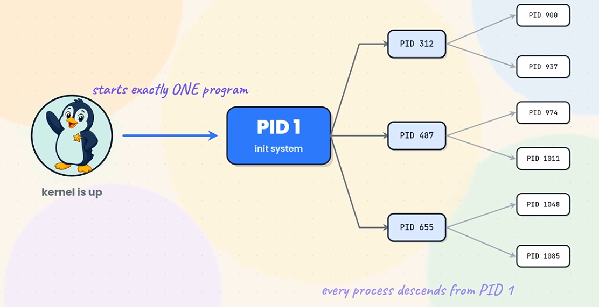

- On every distributions the PID-1 is `systemd`.
- It is like head of operations that unlocks the doors.
- It starts the network, mount disks, launches the login screen, run services like SSH server.
- It restarts crashed ones (the crashed services).

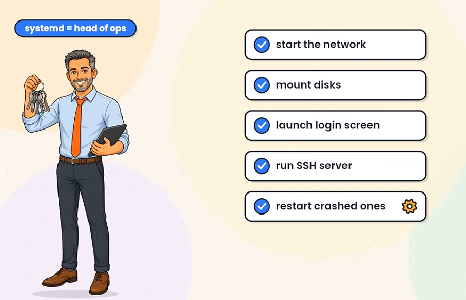

- The systemd organizes operations into UNITS.
- It forms groups of units to achieve the targets (milestones like network is up or graphical desktop)
- You control it with systemctl, for example command like `$ systemctl status nginx` and read it's logs like using `$ journalctl -u nginx`

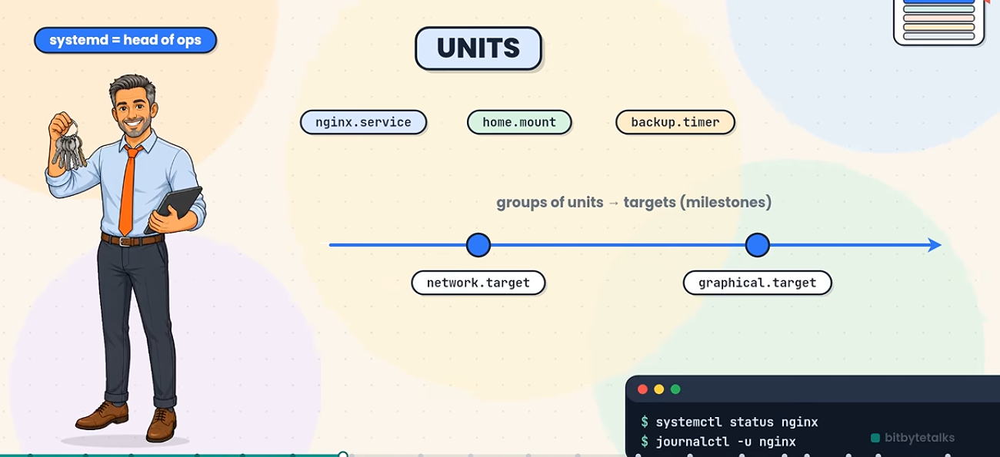

- Not every distribution uses systemd, the distribution like alpine uses OpenRC, and void uses runit. But same role on the map.

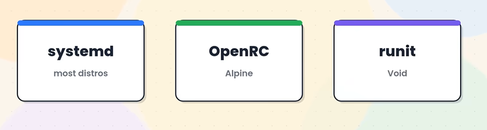

### 07. Userland: GNU and the `C` Library.

- The kernel alone isn't something you can really use.
- You need basic tools to list, copy, search, compress files.
- Many came from the new projects started by `Ricahrd Stallman` in 1983 to build a free Unix-Like operating system. By the 1890s GNU has a compiler, a shell and a mountain of tools, but not finished Kernel.

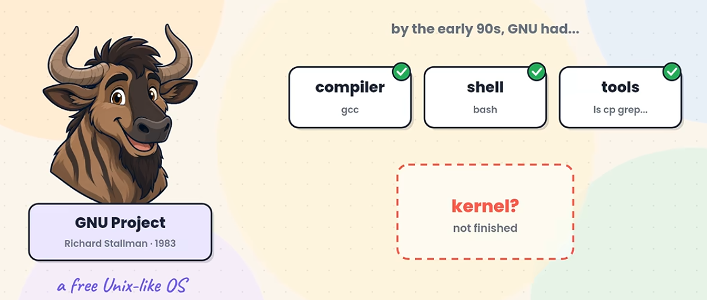

- Then came Linux and made a complete system, which is why some people called it as `GNU/Linux`, tools like ls, cp, mv and cat comes from the package `GNU core utils`. While tools like grep and tar are `separate GNU packages`.

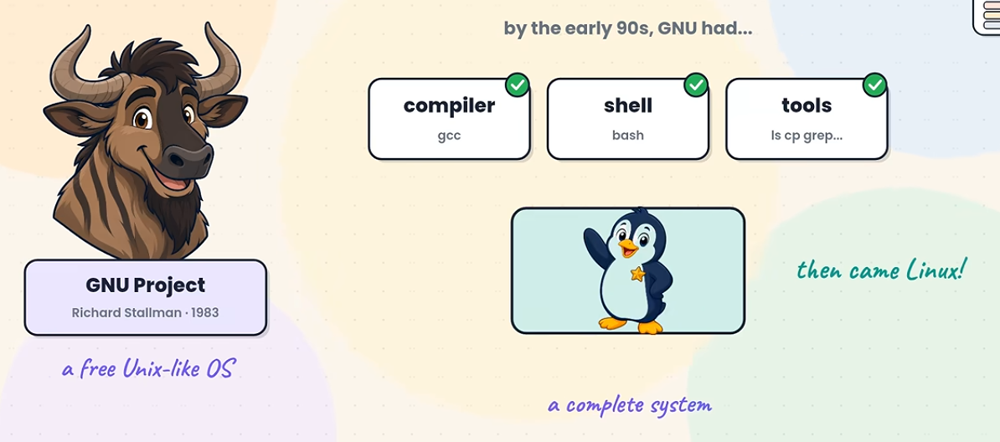

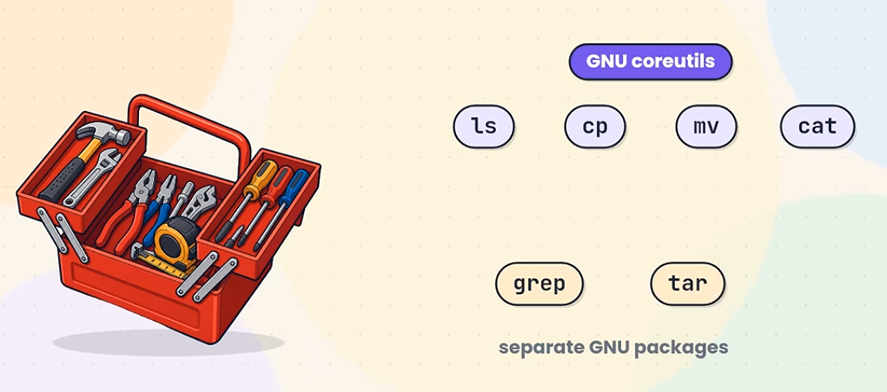

- Sitting quietly between every program and the Kernel is the 'C-Library` or `libc`. Most programs don't make system calls by hand, they call friendly functions in `C-Library` or `libc` and that library makes the system calls for them.

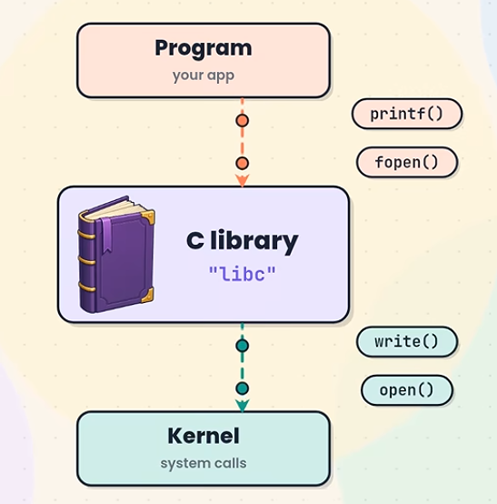

- In the most distributions, that is `glibc` (GNU C Library), the lighter system such as alpine called `musl`, you'll never see it but every program leans on it.

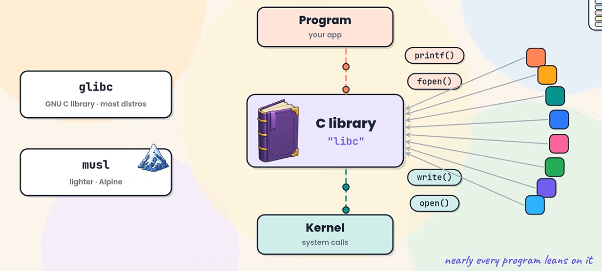

### 08. Terminal and Shell

- The terminal : That draws the text, passes the keystrokes along,
- The shell: It is a program running under Terminal, that actually understands your command.
  
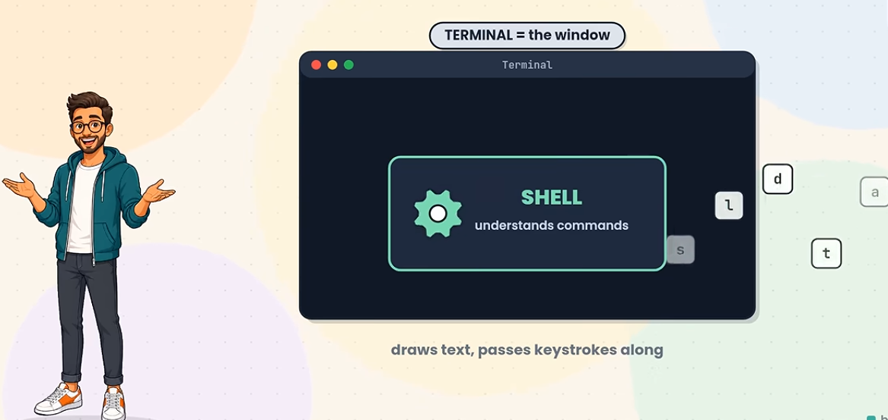

- for example The terminal is like telephone and the shell is the person on the line.

- The most common shell is `BASH (Bourne Again Shell)` the another GNU project.
- The `ZSH` by default on the `MacOs`.
- The `fish` friendly interactive shell.
- The chain commands like PIPE:  `$ cat log.txt | grep error` and shell feeds one program's output into the next, small tools glued together, that's the UNIX philosophy.

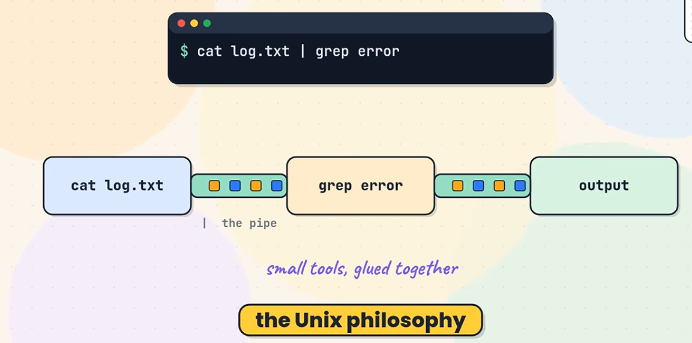

### 09. File System Tree:

- Type `$ ls /` and you will see the unique `Filesystem Hierarchy Standard`.
- Everything hangs out to the single `root`.

1. The `/home` folder: the user personal files.
2. The `/etc` folder: the system like configuration files.
3. The `/bin` folder: the user programs
4. The `/usr/bin` folder: the exact default starting point of programs.
5. The `/var` folder: It holds the things that change. (for example logs).
6. The `/tmp` folder: It is for scratch base.
7. The `/boot` folder: It holds the kernel and GRUB (bootloader) files.

#### From here onwards the magic folders comes intot the `picture`.

8. The `/dev` folder: It holds device file. Your disk literally shows here as a file. (/dev/nvme0n1)
9. The `/proc` and `/sys`: are not the real files on the disk at all, they are windows to kernel opens, so you can peek inside it. Read a file in proc and the kernel generates the answer on the spot. 'Everything is the file' idea again and straight from the VFS.

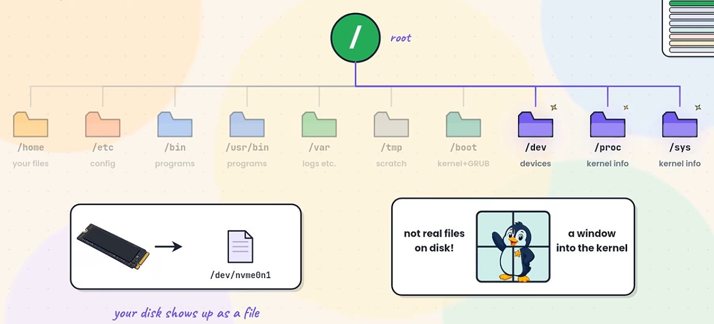

### 10. Distribution:

- Imagine downloading, compiling, and fitting all these pieces together (
  Hardware, Firmware, Bootloader, Linux Kernel, Init system, userland, Shell & Terminal, File system tree) and plus thousands of applications and keeping them updated would be a complete `NIGHTMARE`.
- This problem is solved by the distributions. A distro is a team that picks the pieces, configure and work together and ships them as a one installable system.

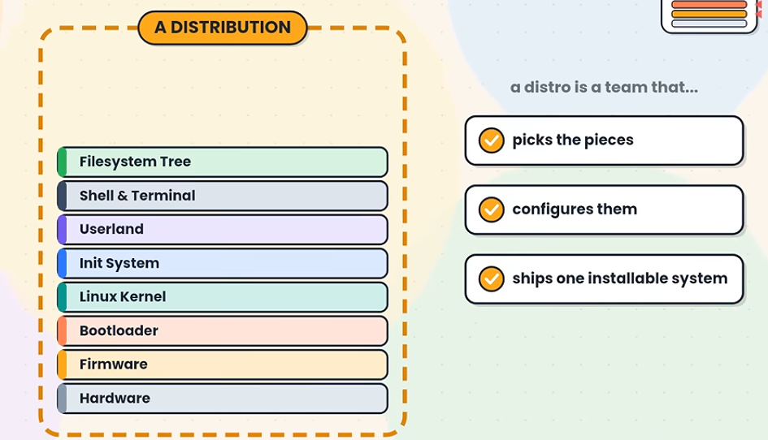  

- The tool that distribution uses to update softwares and install softwares is called package manager. Basically the appstore for the command line that also handles the dependencies for you.

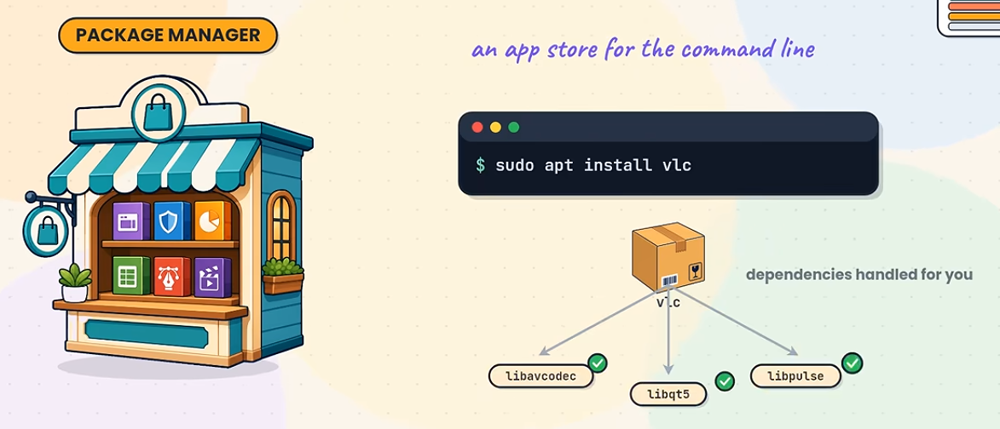

- The distros comes into families.
- 1. Debian Family:
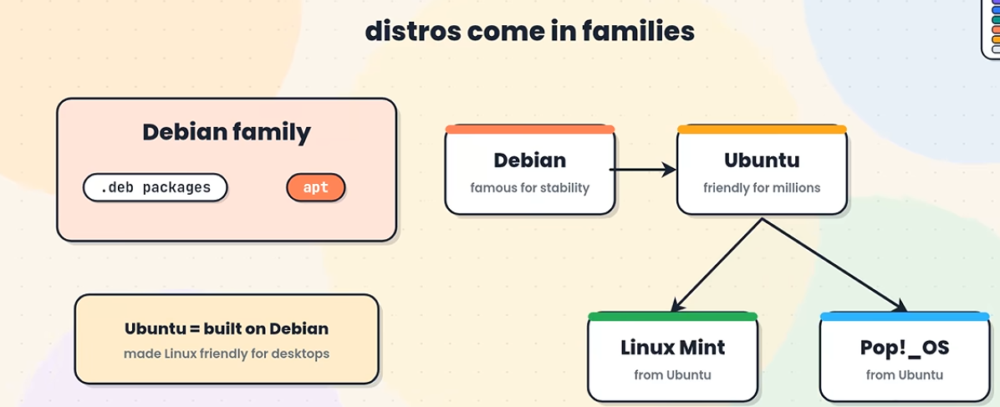

#### All Distro Families with their Package Managers:
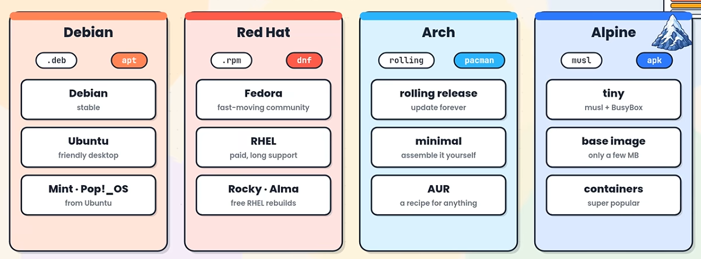

### 11. Display server (Wayland)

- The Linux servers: No single pixel graphics.
- A desktop needs windows + a cursor and that's the display server.
- Today the Fedora and Ubuntu together uses Wayland by default. 

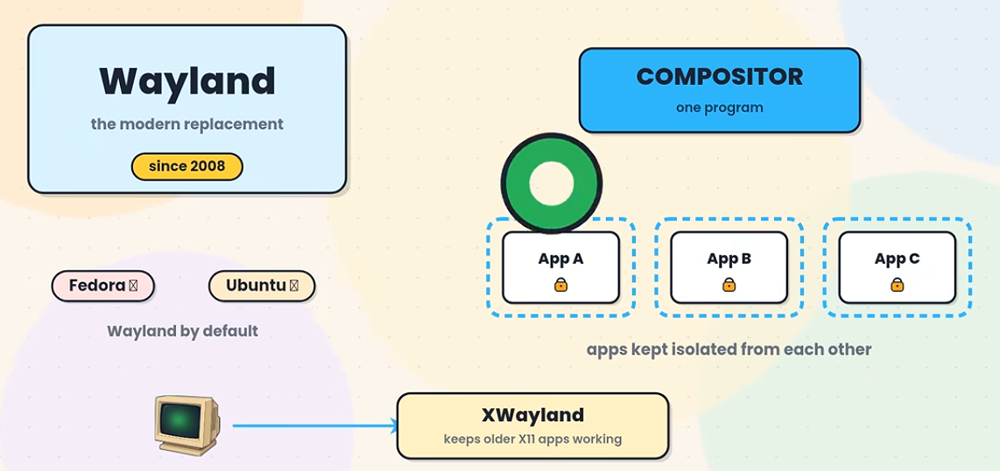

### 12. Apps and Universal Pakages. (The top level)

- Each distribution has their own marketplace for apps or go-to store.
- One app, every distro thats the promise.

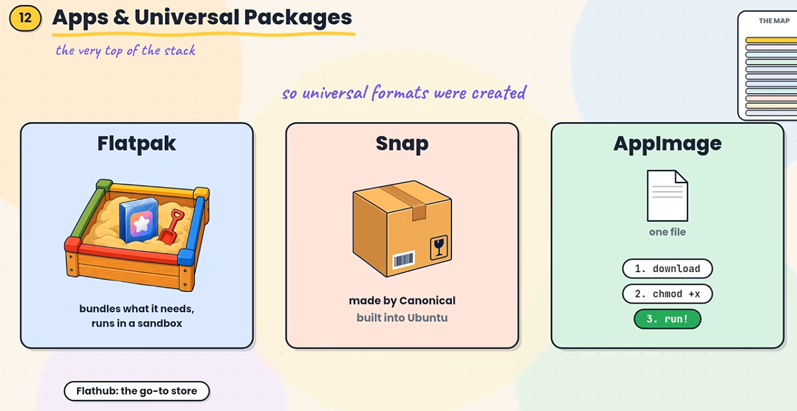

### The Most Majority of the World Servers are Linux. A vast majority of the workloads in the cloud.

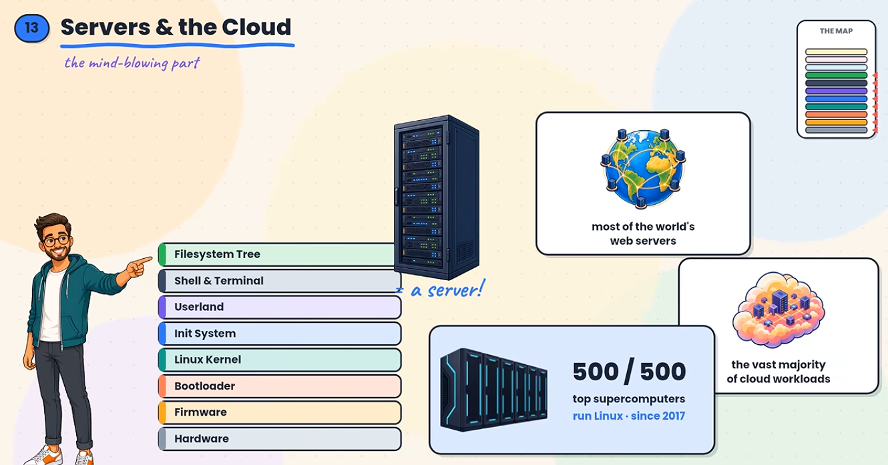

### 13. Containers: The own isolated view of the system.

- The two important the KERNEL features:
- 1. namespaces and 2. cgroup
- They let you give a group of processors their own isolated view of the system.
- Isolated view (for own filesystem, own network, own process list and strict limits on the CPU and memory.)
- Tools like Docker made this easy.
- And Kubernetes manages thousands of containers on many machines. Every containers on the machine shares the host one Linux kernel.
- That's why they start in milliseconds. The tiny alpine image is so popular.

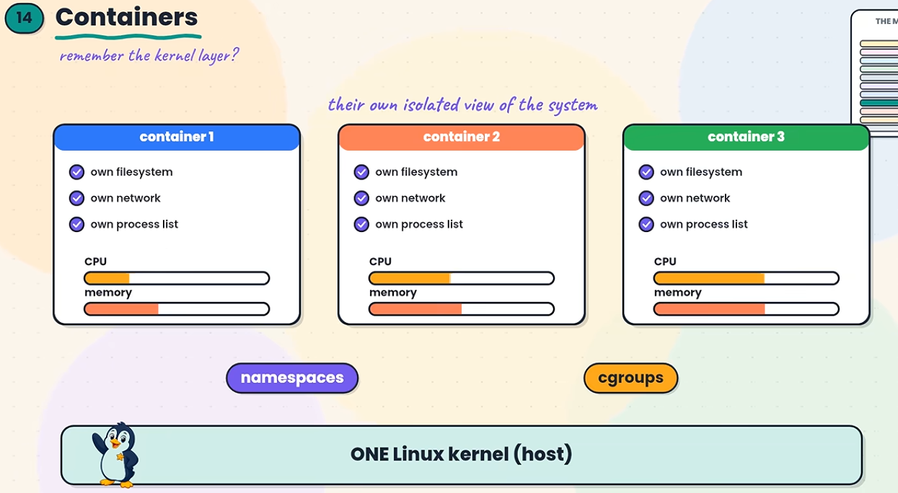

### 14. Android
- Android is works on the Linux Kernel.
- It has it's own `C-Library` or 'libc' called bionic.
- Android has it's own runtime and app framework.

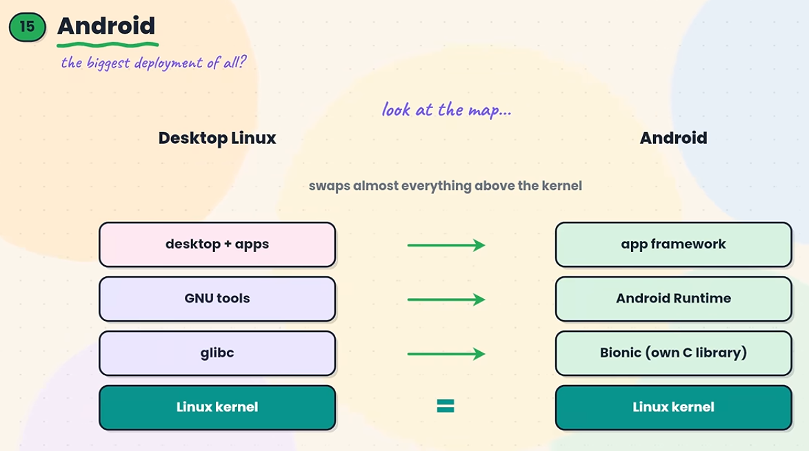

### 15. Whole Map:

- Every word mentioned above has a home.

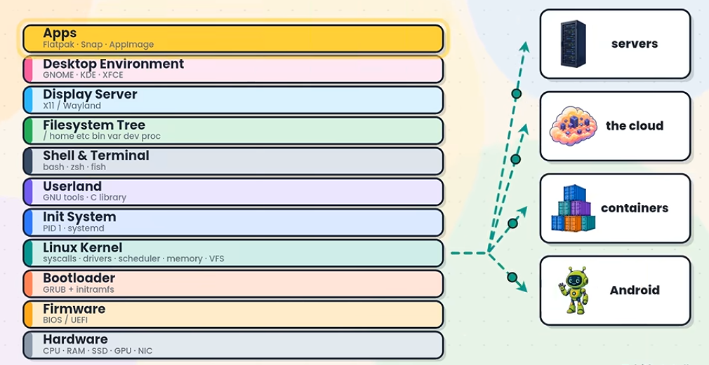

---