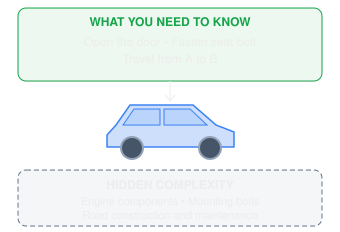
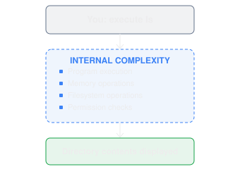
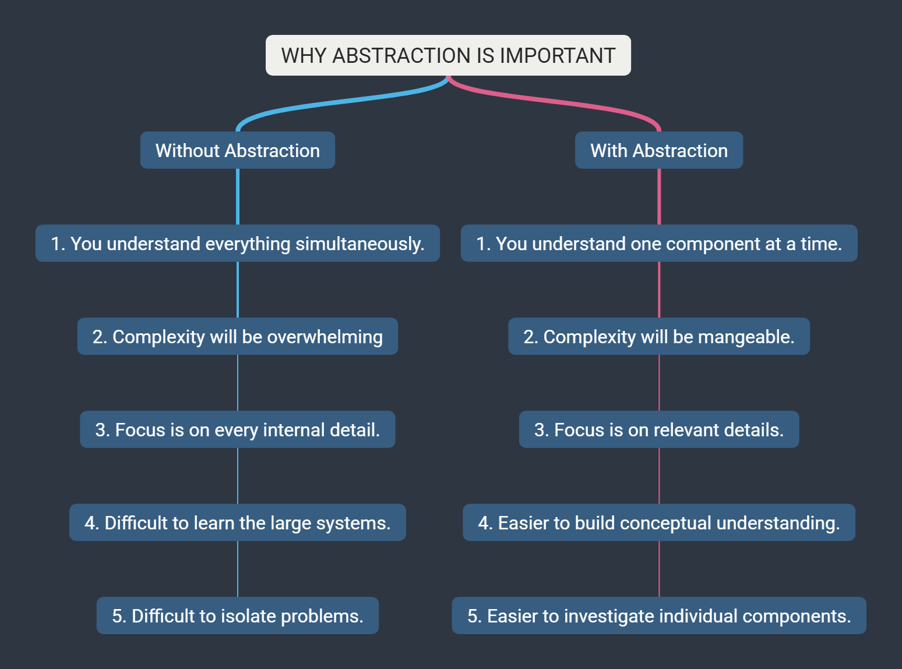
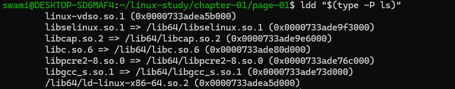
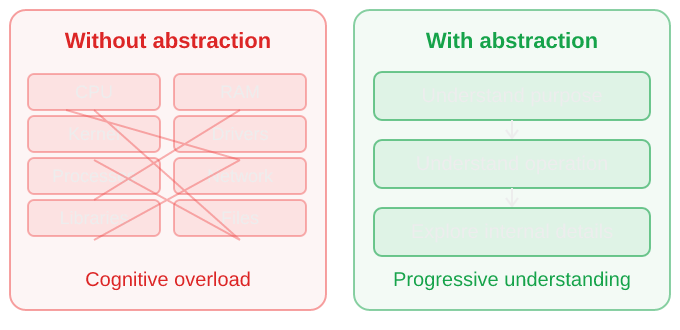
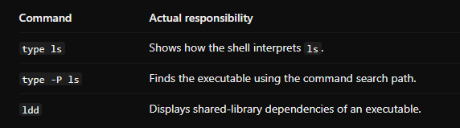
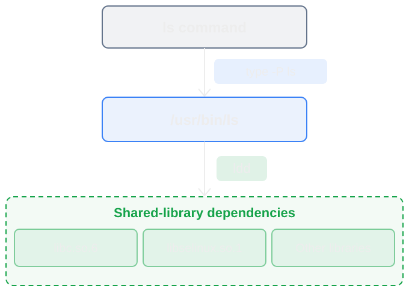
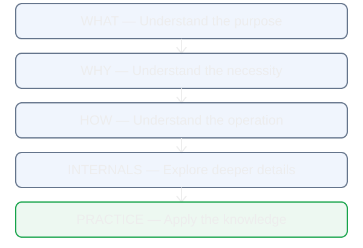

# Chapter1: The Big Picture of Linux (The bird eye view about how Linux Works.)

### Fundamental Concepts about Linux

- The Linux is a complex operating system.
- Multiple software components run and communicate with one another.
- Abstraction helps us understand complex systems without getting overwhelmed by their internal details.

### What is Abstraction?
- Abstraction is a process of hiding unnecessary internal complexity and focusing on the essential purpose and operation of something.

- For example, take real world scenario "The car analogy": Imagine travelling in a car.



- As a passenger, do you need to understand how the engine burns fuel, how the gearbox operates or how the roads were constructed?
- No. You only need to understand the car's purpose and how to use it at the level required for your journey.
- All the underlying complexity still exists. You simply don't need to deal with it at that moment.
- Abstraction `does not eliminate complexity`. It makes `complexity manageable`.

#### Applying the same concept to Linux

- Suppose you execute <mark>$ ls</mark> you know that this command displays directory contents.
- However, behind this simple command, Linux performs various internal operations.



- You don't need to understand every internal operation before using the <mark> ls </mark> command.



---

### <mark>Golden rule: Understand the purpose first. Explore the internal details when necessary.</mark>

---
---

### Lab objective: Understand the difference between using a command and investigating its internal complexity.

#### Step 1: 

```bash
mkdir -p ~/linux-study/chapter-01/page-01
cd ~/linux-study/chapter-01/page-01
```

#### Step 2: 

```bash
touch file1.txt file2.txt file3.txt
```

#### Step 3:
```bash
ls
```

Output:-

```
file1.txt file2.txt file3.txt
```

#### Step 4: Discover the program behind the command.
```
type ls
```
or

```
type -P ls
```

Output:-
```
/usr/bin/ls
```

#### Step 4: To uncover some hidden complexity, (we go inside the unnecessary details here)

```
ldd "$(type -P ls)"
```



#### <mark>The ldd command displays the shared-library dependencies of an executable.</mark>

#### What we have observed here: We have viewed simple ls command first and then we have observed that behind every command there is an executable, and behind that executable there may be several shared libraries.

----
----

### Questions and Answers:

```
Question-1: What is abstraction?
Answer:- Abstraction is the process of hiding unnecessary implementation details and focusing on the essential purpose and operation of a component to make complex systems easier to understand and use.
```
---
```
Question-2: Why is abstraction necessary when learning Linux?
Answer:- 
Abstraction is necessary when learning Linux because it breaks down complex systems into manageable components, allowing us to understand their purpose and operation before exploring their internal implementation
```

---

```
Question-3: Explain abstraction using the car analogy.
Answer:-
If we consider the car analogy, then the user must focus on driving the car by using the steering and fastening the seat belts as well as opening or closing the doors. Users do not need to understand internal car complexity, such as how engine works as well as how the internal system behind each operation he performs, like pressing AC button to have the cool air.
A mechanic, on the other hand, may need to understand those internal details to diagnose a problem if AC have any issues.

```


---
```
Question-4: Does abstraction remove complexity or simply hide it?
Answer:-
Abstraction hides complexity; it does not eliminate complexity.
For example, when Terraform provisions a virtual machine on Google Cloud, you don't need to manually construct HTTP requests to the cloud APIs. However, those underlying operations still take place.
```
---

```
Question-5: What did the ldd command reveal about the ls command?
Answer:-
- The ldd command does not reveal the complete implementation of ls, its source code, or how its internal algorithms operate.
- It reveals a specific part of its underlying complexity: its shared-library dependencies.
- The ldd command revealed the shared libraries that the ls executable depends on. This demonstrates that even a simple Linux command can have underlying software dependencies hidden through abstraction.
```




---
---

### <mark> Notes: </mark>

- Abstraction manages complexity without eliminating it.
- The required depth of understanding depends on the problem being solved.
- Explore internal details when troubleshooting, debugging or optimizing a system.
- type -P → Where is the executable?
- ldd → What shared libraries does it depend on?



---
---