# Understand the concept of Hardlink and Softlink.

### The concept of `inode` number.

- The systems like ZFS, ext4 and others keep track of data with the help of inodes.
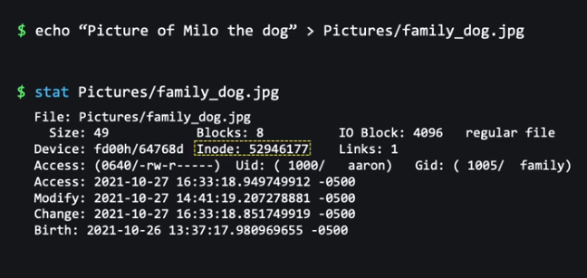

- Inode remembers where all those pieces are stored.
- It also keeps the track of metadata, things like permissions when this data was last modified, last accessed and so on.

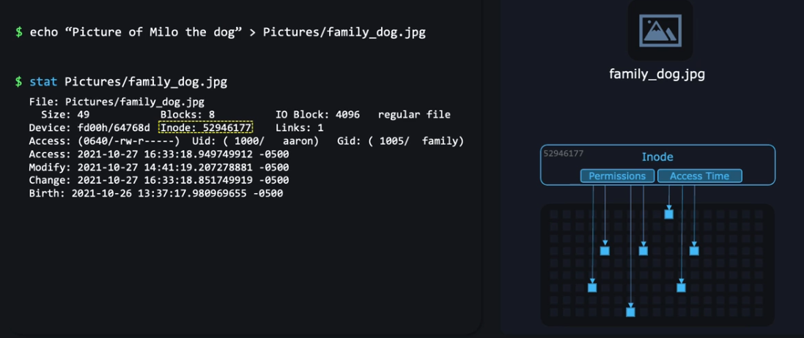

- However, it would be inconvinient to tell the computer to show me inode 52946177 really does. So we work with files instead.
- Here, in example, the file family_dog.jpg
- In this case the file points to the inode and the inode points to all of the blocks of data that we require.
- And finally we acquire, when we use the command $ stat family_dog.jpg
  it shows us how many Links are associated with that file.

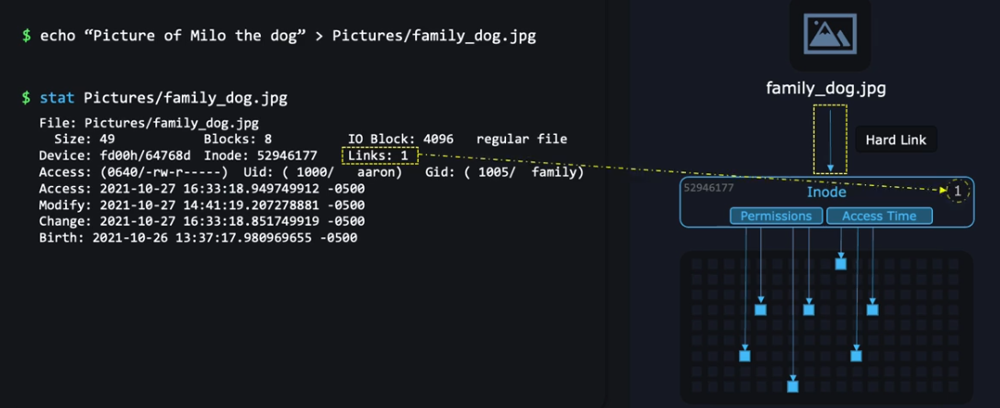

### Why we need more hardlinks for this data.

- Suppose you want to share a same file with another user like jane.
- What generally you will take the action like copy the file from aaron's user path to jane's path. It is a very simple operation by using the cp command in Linux.

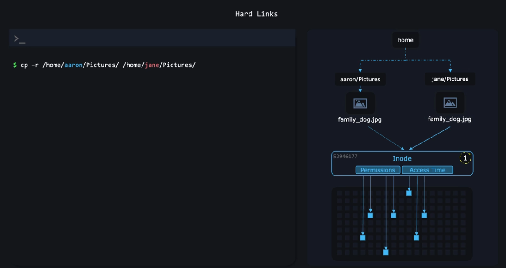

- However, this is the most costly operation we did, think about if there are 5000 of images (20GB) and you want to share those 5000 of pictures with Jane?
- This will acquire a more memory, we will have to store 20GB of data twice.
- Why use 40GB of data when you could just use 20GB?

#### Here the Hardlink will become the exact solution on this. Instead of copying data we will hardlink a data.

#### SYNTAX > $ ln [path_to_target_file_path] [path_to_link_file] 

#### The only special thing about it is instead of pointing to a new inode, it points to same inode as a target file.

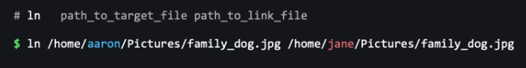

#### Now here the picture `family_dog.jpg` stored only once, but the same data can be accessed at different locations through different file names.
#### After applying command the inode link becomes 2.

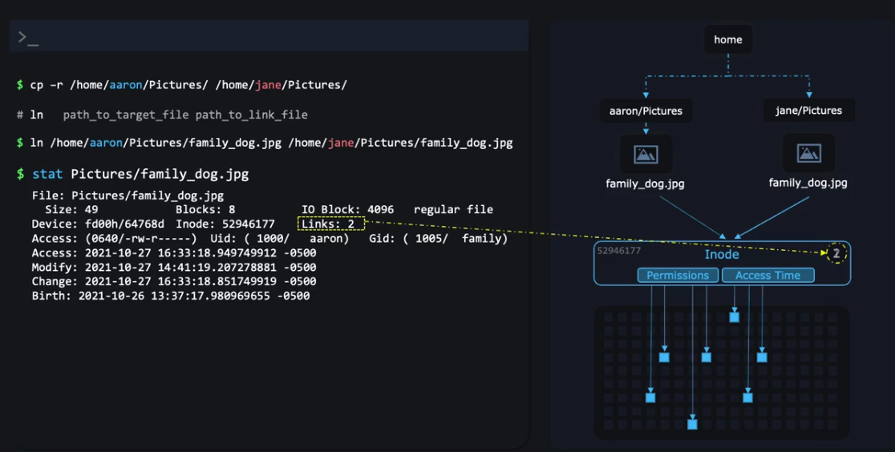

#### Here now the both Aaron and Jane share the same 5000 pictures through hard links.

---

### Delete operation in Hardlink.

#### What if Aaron decided to delete the file `family_dog.jpg` then what will happend with Jane's picture? 
#### Answer: Nothing will happen, as Jane will have access to that data. Because the inode still has one hard link to it.

#### If both deleted the same file from their side then inode will have 0 links. And if there is a 0 link that means data will automatically disappear from the file system.
#### Technically, the data blocks are not actually erased, but they're just marked as unused so that the system can overwrite them with new data. But for the user's persepective the data is gone, so it is intelligently removed only when everyone decides that they don't need it anymore.

### Limitations and Considerations of Hardlink.

#### 1. You can only hardlink the files and not folders or directories.

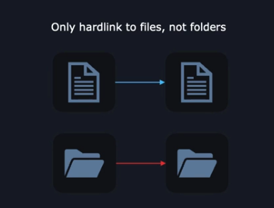

#### 2. Only hardlink to files on the same filesystem, that is if you had an external drive mounted at /mnt/backups then you would not able to backup.

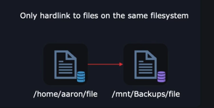

#### 3. All users that accessing the same file for the operation of hardlink must have all the required permissions. The other alternative approach would be both users belong to one single group and that will also solve the problem by having a group the required permissions on that file.

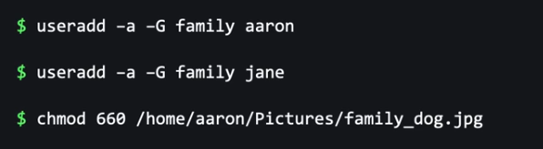

---

## The concept of Softlink

- The hardlink points to inode but the softlink nothing more than the file that links to path instead.
  
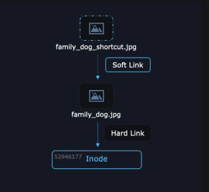  

- It's almost like a text file with a path to file or directory inside.

Here in the softlink we have -s as a symbolic option to differ the hardlink.

> $ ln -s [path_to_target_file] [path_to_link_file]

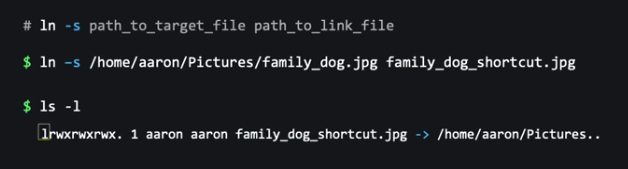

### The alternative command to see the command in softlink is `readlink`

#### > readlink <file_name>

#### The permission here to the softlink file has been given full permissions because the permission to the softlink does not matter.

#### If the original file is deleted or the created softlink file try to have softlink with other file then the softlink path will be broken.

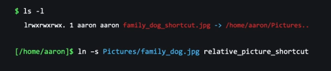

#### You can make softlink for the directories.

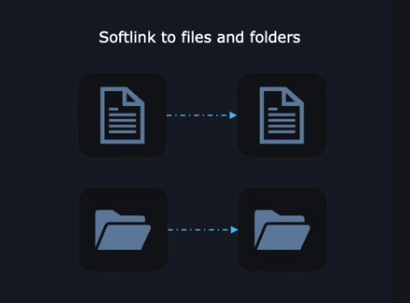

#### You can make the softlink on different file systems.

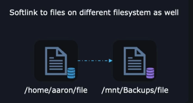

---
