# CONTAINER TECHNOLOGY DEEP OVERVIEW: HOW DOCKER CONTAINERS REALLY WORK.

### The two main Linux Ideas are Namespaces and cgroups.

### 1. Namespaces: Decides what a process can `see`. (Privacy)

- A namespace gives your process its own private view part of the system.
- Same house different windows.
- The linux has several different important namespaces.
- Each one hides different thing.

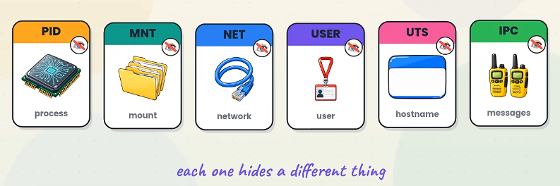

#### 1. Process Namespace. (only sees its own processes.)

- Normally, every program can see every other program with a command like `ps`.
- Inside a process namespace, your container only sees its own processes.
  To it , it looks like process number-1 and the rest of the machine disappears.

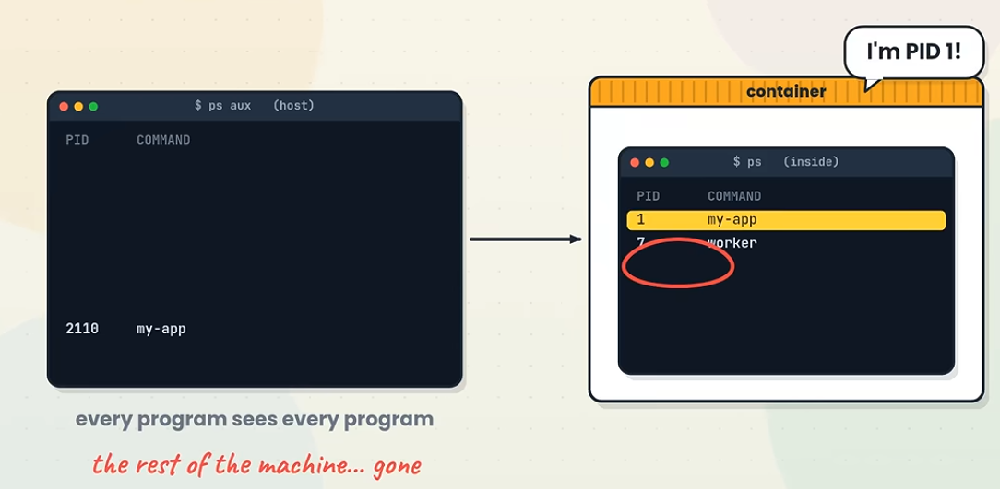

- That is why the program inside a container things it is alone, even when 50 other containers are running next door.

#### 2. The Mount Namespace : This controls the filesystem view.

- Here the host files stay hidden until it shares something on purpose.

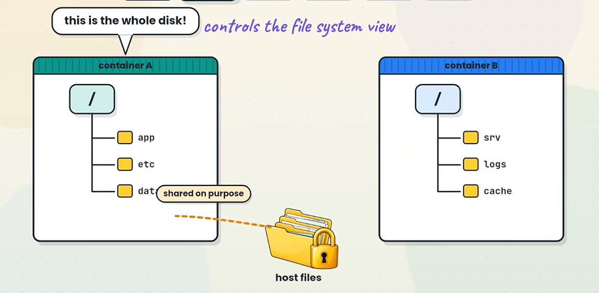

- This is from old school `chroot` chagnes the root folder, however, the mount spaces are stronger and cleaner.
  
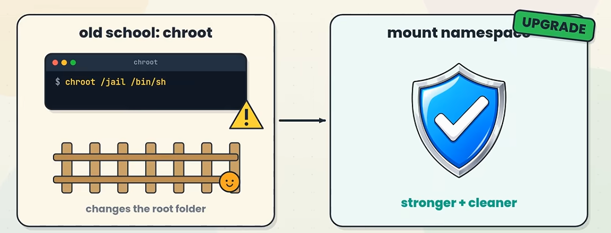

#### 3. The Network Namespace: 

- Each network namespace has it's own network interfaces (eth0).
- It's own IP Address.
- It's own routing table.
- It's own ports.

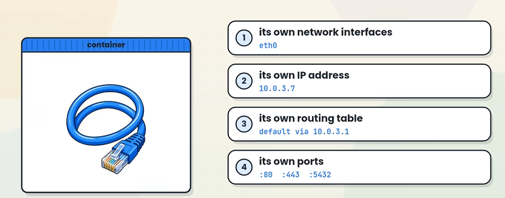

- The two containers are listen on port 80, inside their own world. No Fight.
- From outside you map those to different host ports, if you need to.

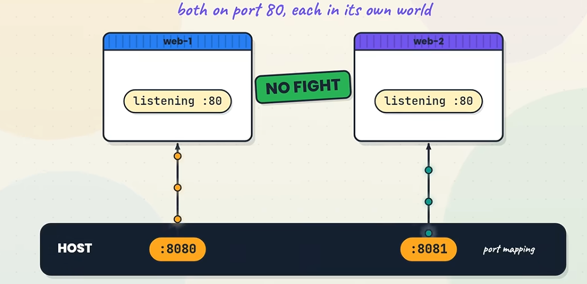

#### 4. The User Namespace: this is about identity.

- Inside the container, the process can think as it is a root.
- Outside the linux can map that to a `normal unprevileged user` on the host. That is a powerful safety trick.
- The root inside does not automatically mean root of your whole machine.

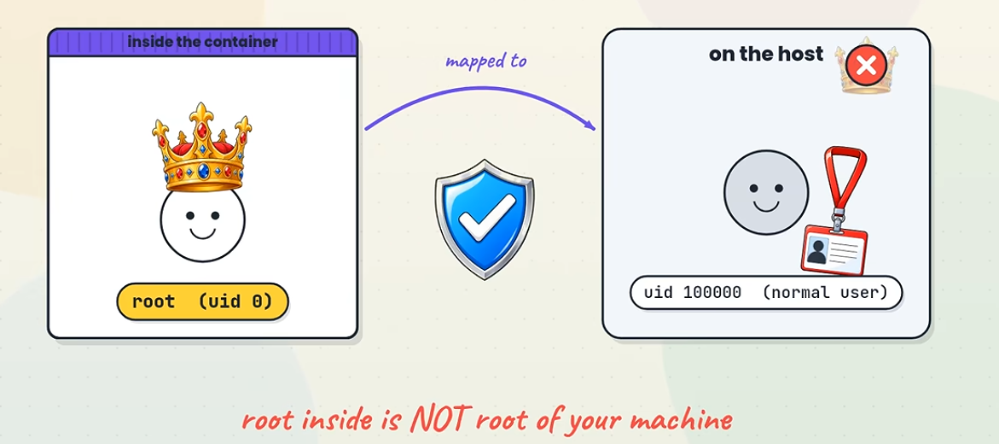

#### 5. The UTS Namespace: it's own hostname.

- The web-container suppose has it's own hostname called `web-1`.
- The database-container suppose has it's own hostname called `db-1`
- Without renaming your actual host computer.
- It's small but useful.

#### 6. The IPC Namespace: The inter process communication.

- This isolates the interprocess communication stuff like shared memory.
- Program that talks through those channels, they stay in their own lane.
  
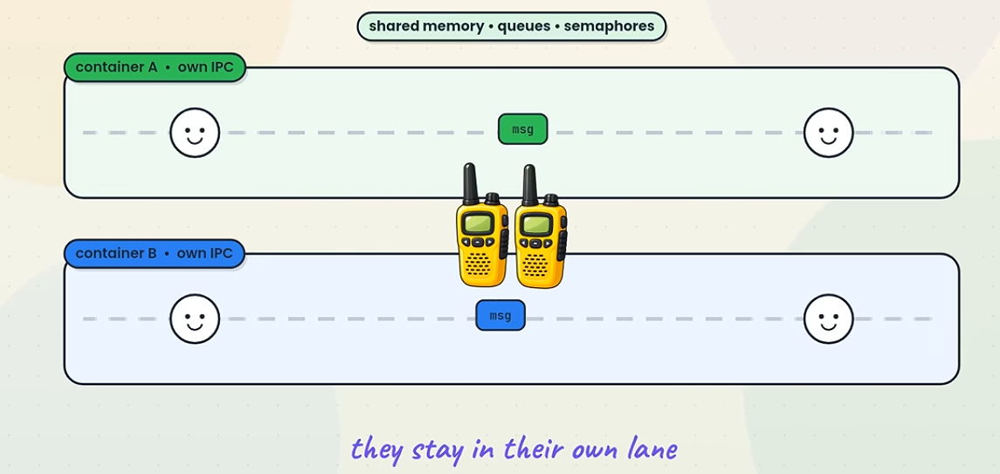

### The main question: What am I allowed to see? (What containers are allowed to see?) And that is why the next picture comes in called 'cgroups', the control groups.

### 2. cgroups: how much it can `USE`. (Limits)

- If namesapces are about privacy the cgroups are about `fairness + limits.`
- Without cgroups one greedy program can eat all the CPU, fill all the memory and make everything else crawl.

- With cgroups the linux can put processes into groups and set the rules.
- You can say this group gets at most two CPU cores. Group it + set rules. Or this group can use only 512 MB of memory. Or this group can write only so much disk per second. OR this group can use only this much network bandwidth.

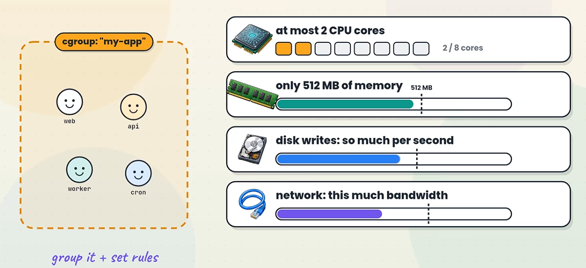

- If the process tries to go beyond the memory limit, Linux can stop it. That protects the rest of the machine.

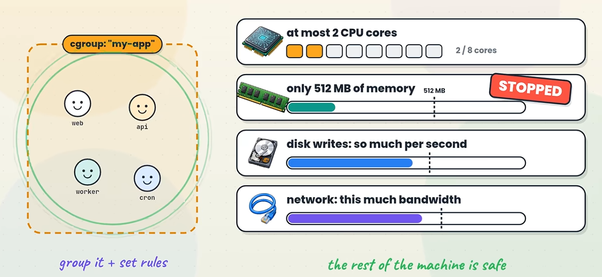

- This is why containers feel practical on real servers.
- You are not just hiding things, you are also preventing noisy neighbours to ruining the party.

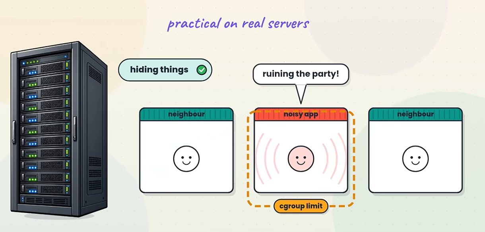

#### Lets make it concrete.

- Suppose you run 3 containers on the one laptop (the host machine) . (one laptop one linux kernel.)
- Container A is a web-app
- Container B is a database.
- Container C is a batch processing job: that processing videos.

- Here, the namesapces makes sure that cotainer A does not see the container B's porcesses or files by default.
- The cgroups makes sure, container 'c' can not grab all the CPU and freeze web-app while you are testing.
- The same machine, separate views, controlled resources.
- That is the real magic behind the modern containers.

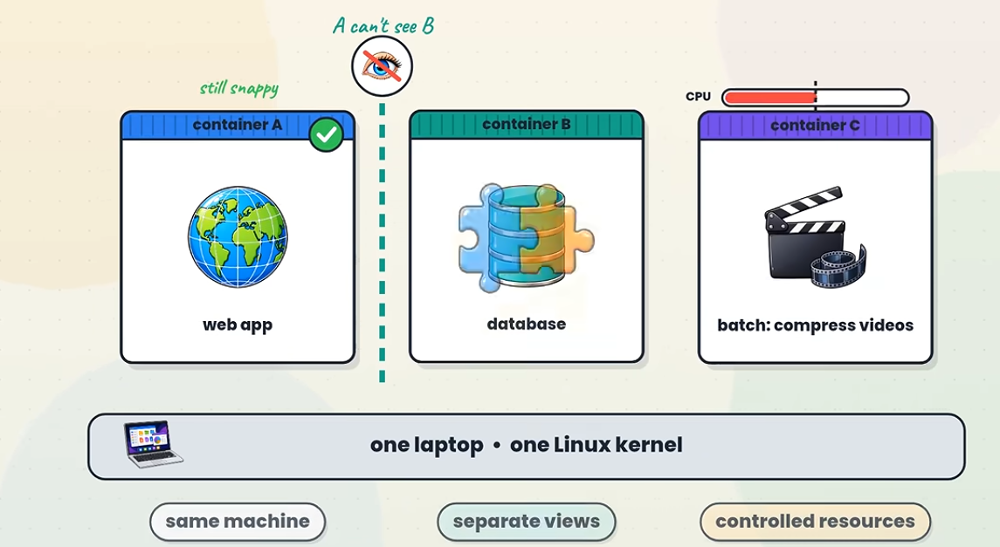

- These foundations were already available in the Linux (the namespace and cgroup).
- The projects like LXC were already building containers from the same kernel features.
- Docker's big win to packaging the workflow so everyday developers could build, ship and run containers without feeling the kernel engieneers.

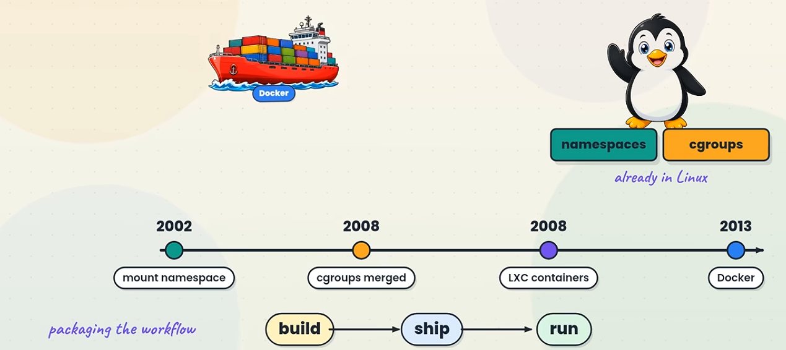

- The package managers have this core recipe to provide the developers a core recipe to ease their work.

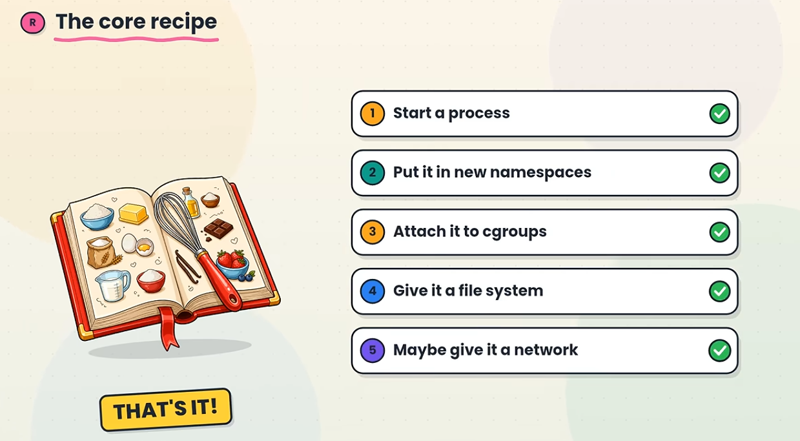

- Tools like Docker, Podman and Containerd are friendly frontends over those Kernel features.

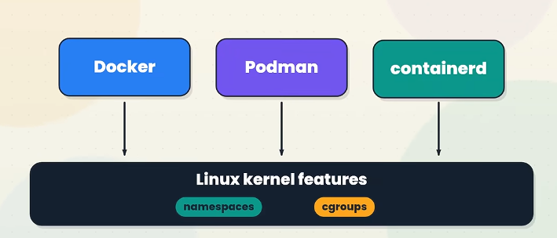

- Inside kubernetes those factors like resource requests are basically cgroup settings with better branding.
- When someone says Give this pods 250m (milicores) and 512Mi (MB of Ram), they are describing a budget. Linux enforces the budget through cgroups.

### A process becoming a container.

- A process starts on Linux, by default it shares everything with the host. Same process list, same network and same mounts, same resource pool.
- The runtime creates a new namespaces for it. New process view, new mount view, new network view, maybe a user mapping too.
- Then it places that processes into cgroups with CPU and memory limits.
- Then it setsup the file system layer so the process sees its own root.

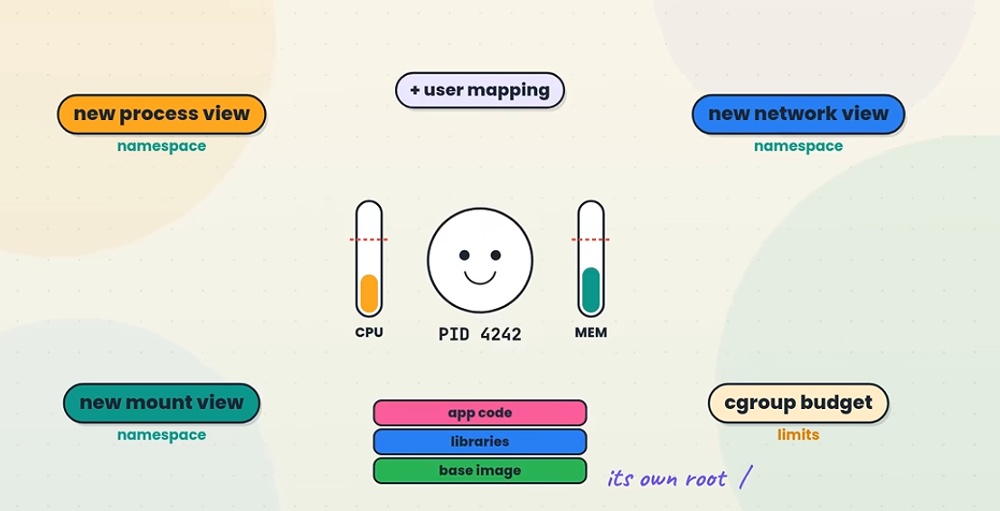

- Now, that process is living in the bubble, not a virtual machine, not a full guest operating system, a filtered view of a linux, with a leash on a apetite. That is a container.

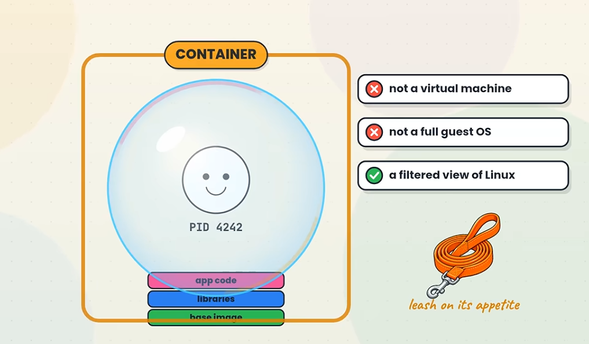

- Containers are not secured as a VM.

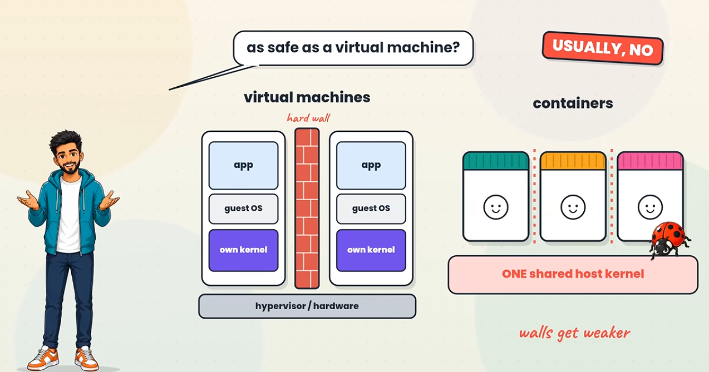

#### That's security still matters for the containers.

- Namespaces and cgroup provides you a strong, practical isolation.

#### Linux capabilities and seccomp:
- Capabilities  break the old all powerful root models into smaller permissions.
- Seccomp can filter which system calls a process is allowed to make fewer dangerous doors.
- You do not need that on day one and namespace and cgroup are the main stage.

#### Are namespaces only for containers: The answer is NO.

- The linux can use them for a lot of things.
- Some VPN tools use network namespaces, some testing tools isolate processes.
- Systemd uses cgroups heavily to manage services on your machine. Even docker is not involved at all.

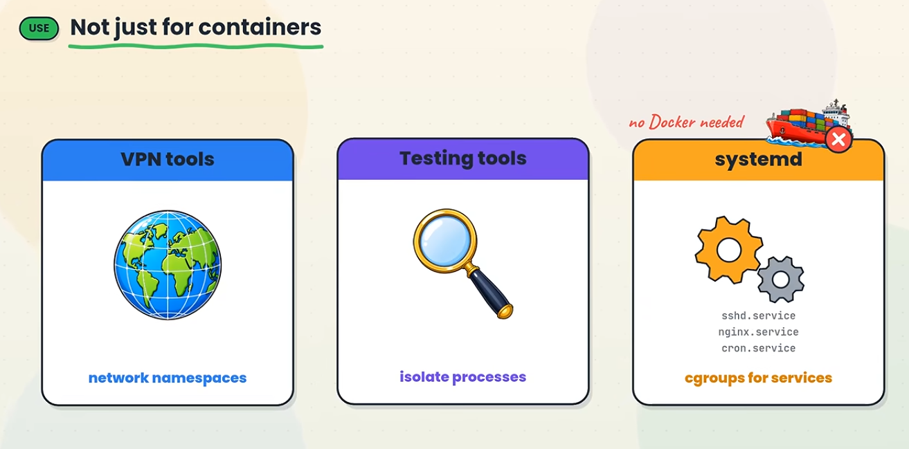

- `cgroups` are quietly shaping what services consume.
- this is how linux manages work.

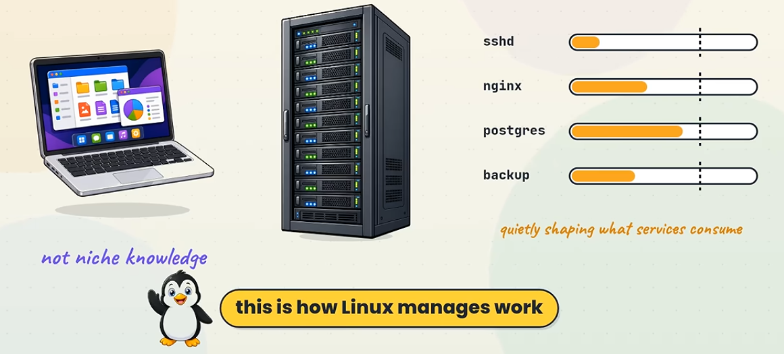

#### Why cloud platforms love containers?

#### privacy + budget = controllable mini-environment.
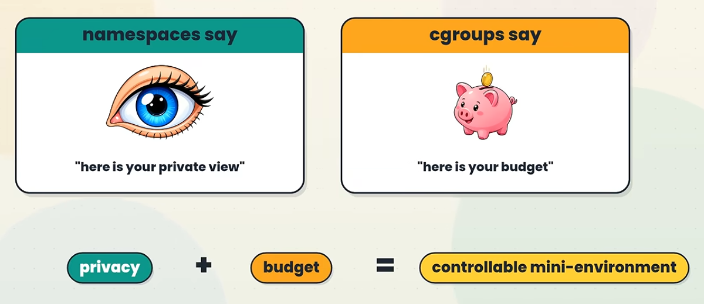

- higher density
- faster startup
- lower overhead

- A virtual machine boots a whole operating system.
- A container starts a process into prepared namespaces + cgroups.
- That is a huge difference in speed and weight.

#### Pictures to rememeber.

- namespace = classrooms
- Think of namespaces like separate classrooms in the same school building.
- Each class has it's own board, its own attendence list, its own door, but the building foundation is shared.

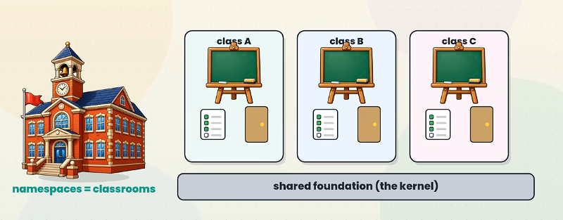

- cgroups = school rules 
- Think of cgroups as school rules for each class.

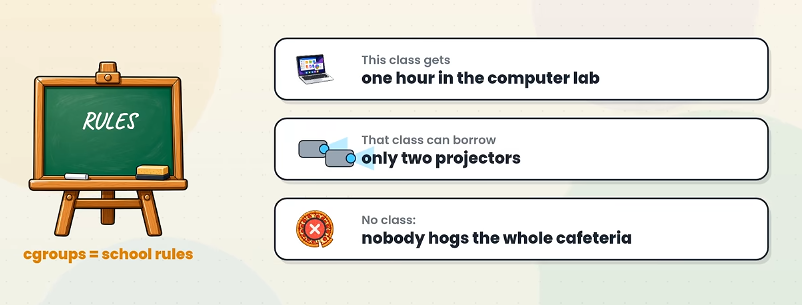

#### Containers are classes with private rooms along with clear budgets.

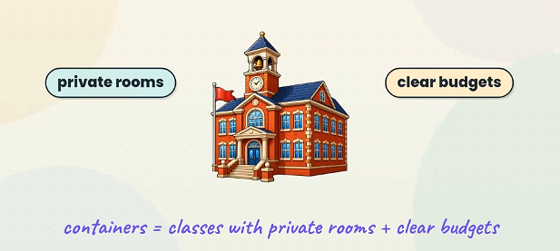

#### Docker talk in plain English.

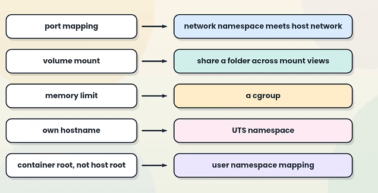

#### Break the containers MYTHS

- Containers are not tiny virtual machines, they are `isolated processes with a shared kernel`.
- Containers are not fully safe, the configuration and kernel security still matter.
- Docker is not the isolation, the linux namespaces + cgroups are real isolation. The Docker is the workflow.
- It is not only used in the huge companies, even a personel project can get cleaner too. Every app environment carries its own environment and limits.

#### Brainstrom:
- Namespaces = hides
- Cgroups = limit
- Container = combine namespaces + cgroups both.

#### Cloud native computing is built on the idea that applications should be packaged, isolated, limited, started quickly and moved easily.
#### Namesapces and cgroups are the Linux engine under that idea.

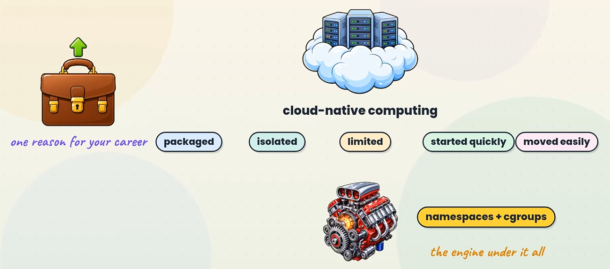

---